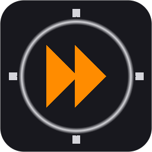
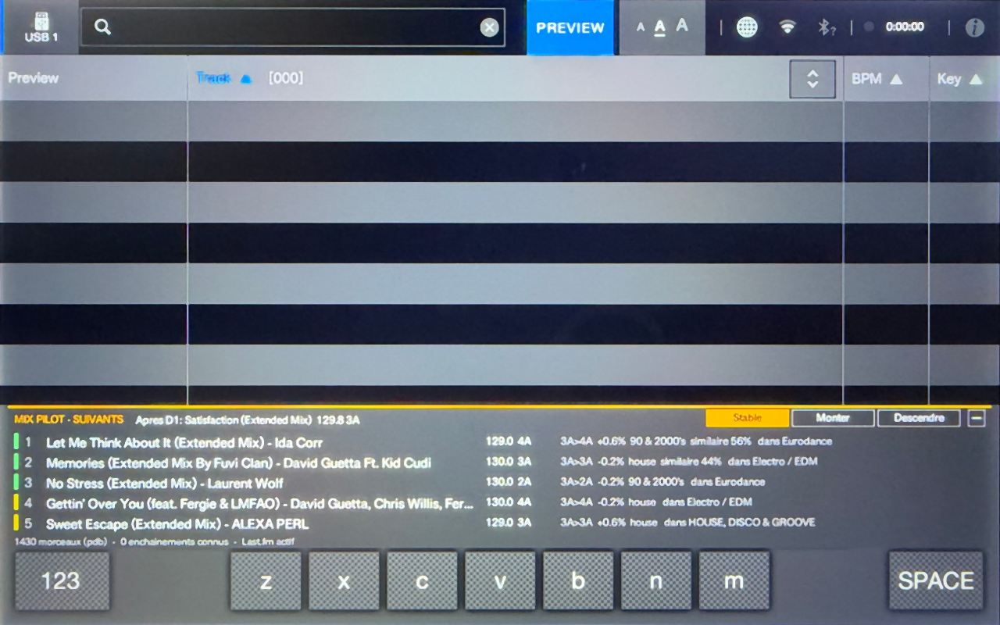
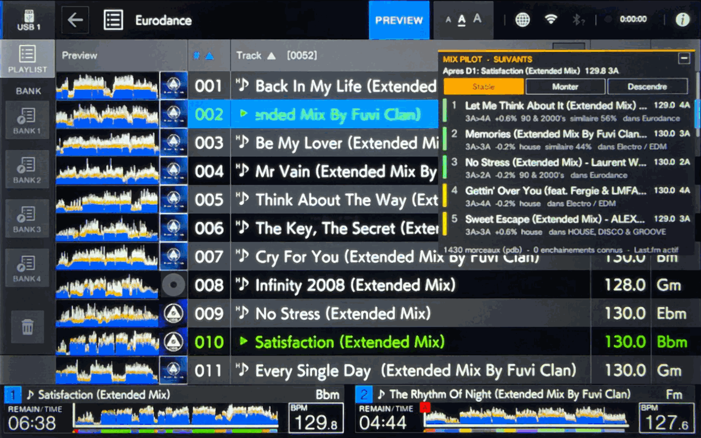
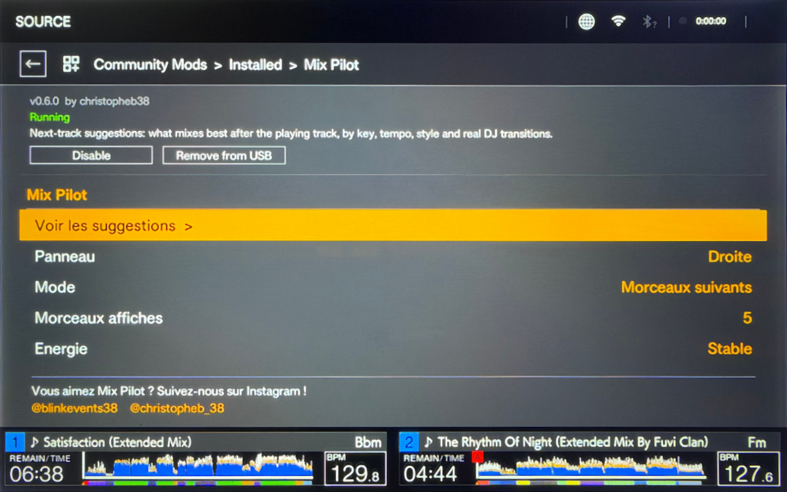

<div align="center">



# Mix Pilot

**Next-track suggestions on the Pioneer DJ XDJ-AZ.**

A community mod for [AZ-MODS](https://github.com/Kyle-Hosman/xdj-az-mods).

</div>

<p align="center">
  
  
  
</p>

Mix Pilot watches what your decks are playing, finds the track in the rekordbox library on
your USB stick, and shows the tracks that mix best after it, right on the BROWSE and SEARCH
screens. It looks at key, tempo, style and the transitions DJs actually play, and it learns
from your own sets.

- **Suggestions while you browse**: a panel on the BROWSE and SEARCH screens, at the bottom
  above the decks (or on the right or left), plus a full-screen page in the Mod Menu.
- **Three energy tabs**: *Smooth* (stay at the same level), *Build up* (lift the energy),
  *Cool down* (bring it down).
- **Two modes**: *Next tracks* (the best tracks to play right after) and *Chain* (an ordered
  plan of several tracks, each mixing into the next).
- **Known transitions**: the transitions you play are remembered and suggested again, and every
  deck shares the [community pairings file](https://github.com/christopheb38/mix-pilot-pairings):
  transitions DJs really play, contributed by Mix Pilot users.
- **Works offline.** With a free Last.fm API key and WiFi, it also uses style tags and
  "similar tracks" from Last.fm.
- **Five languages**: English, French, Spanish, German, Italian.

> [!NOTE]
> Mix Pilot only **reads** your library. It never changes, moves or deletes anything in it. It
> writes only its own files, in its own folder on the USB stick.

<br>

## Contents

- [Requirements](#requirements)
- [Install](#install)
- [Update](#update)
- [Using Mix Pilot](#using-mix-pilot)
- [How a suggestion is chosen](#how-a-suggestion-is-chosen)
- [Settings](#settings)
- [Last.fm (optional)](#lastfm-optional)
- [Known transitions and the pairings file](#known-transitions-and-the-pairings-file)
- [Where Mix Pilot finds your library](#where-mix-pilot-finds-your-library)
- [Files on the USB stick](#files-on-the-usb-stick)
- [Network and privacy](#network-and-privacy)
- [Troubleshooting](#troubleshooting)
- [Limitations](#limitations)
- [For developers](#for-developers)
- [Credits](#credits)

<br>

## Requirements

- An XDJ-AZ running **AZ-MODS 1.2.3 or newer** ([install guide](https://github.com/Kyle-Hosman/xdj-az-mods#install)).
- A USB stick exported with **rekordbox**, with your music analyzed (BPM and key).
- Optional: the deck on **WiFi** and a free **Last.fm API key**, for style tags and similar tracks.

<br>

## Install

### On the deck (recommended)

1. Connect the deck to WiFi.
2. Open **Mod Menu > Community Mods**.
3. If Mix Pilot is not listed under **Browse** yet, add its repository first: **Repositories >
   Add**, then type `christopheb38/mix-pilot`.
4. In **Browse**, open **Mix Pilot** and press **Install**.
5. Press **Reload now** when the deck offers it, or power-cycle the deck.

### With the AZ-MODS desktop app

In the desktop app's **Community Mods** tab, add the repository `christopheb38/mix-pilot` if
needed, select your USB stick and install **Mix Pilot**. Put the stick in the deck and power it on.
Because the mod was not installed from the deck itself, the deck asks once: **Mod Menu >
Community Mods > Installed > Mix Pilot > New mod found: allow? > Allow**, then **Reload now**.

### By hand

1. Download `mix-pilot-<version>.azmod` from the [Releases](../../releases) page.
2. Unzip it into `MODS/community-mods/mix-pilot/` on your USB stick (it holds `azmod.json`,
   `mix-pilot.so`, `icon.png`, `LICENSE` and `assets/`).
3. Add the line `community-mods.mix-pilot = on` to `MODS/azmods.cfg`.
4. Power the deck on with the stick in, then **Mod Menu > Community Mods > Installed > Mix Pilot
   > Allow**, then **Reload now**.

<br>

## Update

Updates come from the same place you installed from: **Mod Menu > Community Mods > Browse >
Mix Pilot > Update**, then **Reload now**.

> [!TIP]
> The deck refreshes its list of mods the first time you open Community Mods after a power-on,
> then at most every 10 minutes. If a new version does not show up yet, power-cycle the deck
> (on WiFi) and open Community Mods again.

<br>

## Using Mix Pilot

### The panel

Load a track and open **BROWSE** (or a playlist, the Tag List or SEARCH). The Mix Pilot panel shows:

```
MIX PILOT - NEXT   After D1: Every Single Day (Extended Mix)  130.0 8A    [Smooth][Build up][Cool down]  [-]
|  1  Infinity 2008 (Extended Mix) - Guru Josh Project     128.0  8A   8A>8A  -1.5%  eurodance   in Eurodance
|  2  People Hold On (Extended Mix) - Mike Candys          128.0  9A   8A>9A  -1.5%  eurodance   in Eurodance
...
1430 tracks (pdb)  -  12 transitions known  -  Last.fm on
```

Each suggestion shows its title and artist, its BPM and Camelot key, and why it was chosen: the
key move (`8A>9A`), the pitch change needed (`-1.5%`), a shared genre or tag, `mixed 3x` when
it is a transition you have played, `similar 65%` when Last.fm links the two tracks, and **the
playlist where you will find it** (`in Eurodance`).

The colored bar on the left is the match quality: **green** very good, **yellow** good,
**orange** possible, **blue** a transition you (or the community) actually played.

| On the panel | Does |
|---|---|
| Tap a tab: **Smooth**, **Build up**, **Cool down** | shows the suggestions for that energy (all three are computed together, so switching is instant) |
| Tap anywhere else | switches between **Next tracks** and **Chain** |
| Tap **–** (top right) | folds the panel to one line with the top suggestion; **+** opens it again |

### Next tracks or Chain

- **Next tracks**: the best tracks to play **right after** the current one. They are
  alternatives for the next slot: pick one.
- **Chain**: a **plan**. Track 1 goes after the current track, track 2 after track 1, track 3
  after track 2, and so on (a beam search over the same transition score).

### Which deck it follows

In **Auto** (the default), Mix Pilot follows the deck that most recently started playing, once
it has played for 6 seconds. If nothing is playing and only one deck has a track loaded, it plans
after that track. You can also pin it to one deck (**Follow** setting).

Tracks loaded on the other decks and tracks already played in this session are never suggested.

### The Mix Pilot page

**Mod Menu > Mix Pilot** opens the mod's page: every setting, the Last.fm key, Reload library,
and **Show suggestions** for the list in full screen (turn the knob there to change the
energy tab, click to switch Next tracks / Chain). Turn the knob to pick a row and click (or tap
the row) to change it. **BACK** returns.

<br>

## How a suggestion is chosen

Every track in your library is scored as a next track for the playing one:

| Signal | Weight | What it measures |
|---|---|---|
| **Key** | 24% | Harmonic distance on the Camelot wheel: same key, ±1, relative major/minor, energy boost (+2), one semitone up (+7) |
| **Tempo** | 24% | The pitch change needed, half and double time included |
| **Known transition** | 22% | How often this exact transition was played: by you (learned on the deck) and by the community |
| **Style** | 18% | rekordbox genre, Last.fm tags, and the playlists both tracks are in (a huge "all tracks" playlist counts for little) |
| **Similarity** | 12% | Last.fm "similar tracks": people who listen to one also listen to the other |

The **energy tab** then shifts the ranking. Rekordbox gives no energy value, so energy is
estimated from tempo and key: *Build up* favors tracks a little faster and keys moving up the
wheel, *Cool down* the opposite, *Smooth* the same tempo and key.

The **Avoid same artist** setting ranks the playing artist's other tracks a little lower.

**Duplicates.** When your library holds the same song twice, it is suggested once: the copy
you **sorted** (in playlists, rated with stars, colored) wins, then the one that mixes better.
Nothing is removed from your stick.

<br>

## Settings

All settings are on the Mix Pilot page (**Mod Menu > Mix Pilot**) and are kept by the deck.

| Setting | Values | Default |
|---|---|---|
| **Show suggestions** | opens the list in full screen | |
| **Panel** | Bottom (one line per suggestion, full width, above the decks), Right, Left, Hidden | Bottom |
| **Mode** | Next tracks, Chain | Next tracks |
| **Tracks shown** | 4, 5, 8, 10 | 5 |
| **Energy** | Smooth, Build up, Cool down (the tab shown on the panel) | Smooth |
| **Follow** | Auto, Deck 1, Deck 2, Deck 3, Deck 4 | Auto |
| **Avoid same artist** | On, Off | On |
| **Learn my transitions** | On, Off | On |
| **Learn from rekordbox history** | On, Off: also count the transitions in the play histories saved on the stick (see below) | Off |
| **Online (Last.fm)** | On, Off (Off: no network access at all) | On |
| **Language** | English, Francais, Espanol, Deutsch, Italiano | English |
| **Last.fm key** | your API key, typed on a 0-9 / a-f keypad | none |
| **Reload library** | reads the library, `config.txt` and the pairings files again; the row shows `reading...`, then `OK - <number of tracks>` | |

<br>

## Last.fm (optional)

Last.fm adds **style tags** (house, reggaeton, eurodance...) and **similar tracks** to the
scoring. Everything else works without it.

### 1. Get a free API key

1. Sign in (or sign up) at [last.fm](https://www.last.fm).
2. Open <https://www.last.fm/api/account/create> and fill in the form: any application name
   (for example `Mix Pilot`) and description. The callback URL and homepage can stay empty.
3. Last.fm shows two values. Keep the **API key**: 32 characters, digits and the letters a to f.
   You do **not** need the "Shared secret". You can find your key again at
   <https://www.last.fm/api/accounts>.

### 2. Enter it, on the deck or on a computer

**On the deck (easiest):** **Mod Menu > Mix Pilot > Last.fm key**. A 16-key pad (0-9, a-f)
opens. Turn the knob to pick a key and click to type it, or tap the keys. **Delete** removes the
last character, **Clear all** empties the field, **OK** saves, **Cancel** (or BACK) leaves
without saving. The row then shows the start and end of your key (`1a2b...9f`). Saving an empty
key removes it.

**On a computer:** Mix Pilot creates `MODS/community-mods/mix-pilot/data/config.txt` on your
USB stick the first time it runs. Open it with a text editor and put your key after the equals
sign:

```
lastfm_api_key=0123456789abcdef0123456789abcdef
```

Put the stick back in the deck and choose **Reload library**. A key typed on the deck takes
precedence over the one in the file.

### 3. Check that it works

The status line at the bottom of the panel says:

| Status | Meaning |
|---|---|
| `Last.fm on` | working |
| `Last.fm: add a key in config.txt` | no key yet (the network part of the deck is ready) |
| `Last.fm: key refused` | Last.fm rejected the key: check it, character by character |
| `Last.fm unreachable (...)` | no answer; the reason follows, for example a network error code. Check the deck's WiFi |
| `offline` | the deck has no network library |
| `online off` | the **Online (Last.fm)** setting is off |

Mix Pilot asks Last.fm with the **base title** and the **first artist** (`Be My Lover` by `La
Bouche` for "Be My Lover (Extended Mix By ...)" by "La Bouche feat. ..."). A track Last.fm does
not know is normal and is not an error. Answers are cached on the stick, so a track looked up
once stays enriched offline, at a gig without WiFi.

<br>

## Known transitions and the pairings file

Mix Pilot can tell you that "everybody plays B after A". It gets that from four places:

1. **Your own sets.** When a track has played for 40 seconds after another one, Mix Pilot writes
   the transition to `my-transitions.tsv` on your stick (turn this off with **Learn my
   transitions**). Next time, that transition comes up in **blue**, with `mixed 2x`.
2. **Your rekordbox history** (optional, **Learn from rekordbox history**, off by default). The
   players save play histories on the stick (rekordbox's HISTORY playlists); Mix Pilot counts each
   track that followed another in them as a played transition. It is off by default because it
   brings your past sets back: leave it off when you want fresh ideas. It needs the library read
   from `export.pdb` (see [Where Mix Pilot finds your library](#where-mix-pilot-finds-your-library)).
3. **The community pairings file**, shared by every deck:
   [**christopheb38/mix-pilot-pairings**](https://github.com/christopheb38/mix-pilot-pairings).
   Mix Pilot downloads it at start and on **Reload library** while **Online (Last.fm)** is on
   (no Last.fm key needed for it), and `assets/pairings.tsv` ships with the mod.
4. **Last.fm similar tracks** (listener co-occurrence), with a Last.fm key.

### Share your transitions with everybody

The more DJs share, the better the suggestions get for all. Your transitions are in
`MODS/community-mods/mix-pilot/data/my-transitions.tsv` on your stick:

- open a **pull request** on [mix-pilot-pairings](https://github.com/christopheb38/mix-pilot-pairings)
  that adds your lines to `pairings.tsv` (an automatic check validates the format), or
- open an **issue** there titled *My transitions* and attach the file: it will be merged for you.

### The format

All pairings files use the same format: one transition per line, tab-separated.

```
From artist	From title	To artist	To title	count	date
```

`count` (1 to 50) and `date` are optional. Lines starting with `#` are comments. Titles are
matched loosely: `(Original Mix)`, `(Extended Mix)`, `feat. X`, case and accents do not matter,
but a named remix (`(Fisher Remix)`) is a different track.

### Another file, or none

`pairings_url` in `config.txt` chooses the shared file: empty uses the community file, an
`https://` address uses yours (for example your crew's own list), `off` uses none. Then choose
**Reload library**.

```
pairings_url=https://raw.githubusercontent.com/someone/pairings/main/pairings.tsv
pairings_url=off
```

<br>

## Where Mix Pilot finds your library

1. **Through AZ-MODS' library service**, which reads `PIONEER/rekordbox/exportLibrary.db`
   (rekordbox's *Device Library Plus*) on a stick plugged straight into **USB 1** or **USB 2**.
2. **Otherwise, from `export.pdb`**, which Mix Pilot reads itself, in `PIONEER/rekordbox/` or in
   the **hidden `.PIONEER/rekordbox/`** folder, where rekordbox sometimes keeps the library (for
   example on a Mac-formatted stick). This format is publicly documented and not encrypted. It also
   brings each track's **genre**, **stars** and **color**. The status line then shows `(pdb)` after
   the number of tracks.

If the playing track is not found by its rekordbox id, it is matched by artist and title.

When no library is found, the panel says why:

| Message | What to do |
|---|---|
| `No exportLibrary.db: export with Device Library Plus` | the stick has only an old-format library that could not be read: export it again from rekordbox |
| `Library is in the hidden .PIONEER folder` | the library is in `.PIONEER/rekordbox/` but has no readable `export.pdb`: export the stick again from rekordbox |
| `USB stick found, but no rekordbox export on it` | there is no `PIONEER/rekordbox` folder: the music was copied without a rekordbox export |
| `USB port not recognized: plug the stick straight in` | the stick is behind a hub or an adapter |
| `The deck sees no USB stick` | no stick is mounted |
| `Library refused by the deck (codes below)` | open an issue with the status line (see below) |

The status line then reads like `USB1 -1/-1  USB2 -1/-1  sda1:db p1 P+ R5 H:db+pdb`:

| Part | Meaning |
|---|---|
| `USB1 -1/-1` | what AZ-MODS' library service answered for that port (tracks / playlists; -1 = nothing) |
| `sda1` | the stick's device |
| `db`, `pdb`, `-` | `exportLibrary.db`, `export.pdb`, or neither, in `PIONEER/rekordbox/` |
| `p1`, `p2`, `p0` | the USB port (0 = not recognized) |
| `P+`, `P-` | the `PIONEER` folder exists or not |
| `R5` | files in `PIONEER/rekordbox/` (`R-1` = no such folder) |
| `H:db+pdb` | library files in the hidden `.PIONEER/rekordbox/` folder |

<br>

## Files on the USB stick

Mix Pilot keeps its files in its own data folder, `MODS/community-mods/mix-pilot/data/`. It is
created by AZ-MODS, kept when the mod is updated, and deleted when the mod is removed.

| File | Contents |
|---|---|
| `config.txt` | `lastfm_api_key=` and `pairings_url=` (created on the first run) |
| `my-transitions.tsv` | the transitions you played (pairings format, one line each): share it! |
| `community.tsv` | the community pairings file (or your `pairings_url`), as last downloaded |
| `lastfm-cache.tsv` | Last.fm answers, so they are not asked twice (reset past 8 MB) |

All of these are plain text: you can open, edit, back up or delete them on a computer.

<br>

## Network and privacy

- Mix Pilot uses the network **only** with **Online (Last.fm)** on, and only for:
  - **Last.fm** (`ws.audioscrobbler.com`): the artist and title of tracks, and your API key;
  - the **community pairings file** on GitHub (`raw.githubusercontent.com`), or the
    `pairings_url` you set in `config.txt` (`off` for none).
- Everything goes over **HTTPS**, through the deck's own libcurl, outside the audio path, with
  timeouts and size limits. If the network is down, Mix Pilot waits and tries again later; the
  suggestions keep working offline.
- Nothing about your sets is sent anywhere. Your transitions stay in `my-transitions.tsv` on
  your stick unless you share that file yourself.

<br>

## Troubleshooting

**The panel says it found no library.** See [Where Mix Pilot finds your library](#where-mix-pilot-finds-your-library):
the message says what to do.

**"Deck 1: track not in the USB library".** The playing track is not in the library Mix Pilot
read (for example a track from another stick inserted after the deck started). Choose
**Reload library**.

**Some suggestions have no playlist ("in ...").** Those tracks are in no playlist on the stick.

**Accented letters look plain** (`Cafe` for `Café`). On purpose: the deck's font cannot draw
accented letters, so Mix Pilot writes them without accents.

**The panel covers the end of the track list.** Fold it with **–**, or move it with the
**Panel** setting (Right, Left, Hidden).

**I do not see a new version.** Power-cycle the deck on WiFi, then open Community Mods again.

**I want the deck stock for a gig.** Switch Mix Pilot off under **Mod Menu > Community Mods >
Installed**, or set **Online (Last.fm)** to Off to keep the suggestions without any network use.

<br>

## Limitations

- **A suggestion cannot be loaded onto a deck from the panel.** AZ-MODS gives mods no way to load
  a track; the panel tells you the playlist where each suggestion is.
- **The panel is drawn over the track list.** Mods can draw on the screen but cannot shrink the
  deck's own list. Fold it with **–** when you need the space.
- **Energy is estimated** from tempo and key; rekordbox has no energy value.
- **Genre, stars and color** are used only when the library is read from `export.pdb`; AZ-MODS'
  library service does not provide them.

<br>

## For developers

Mix Pilot is written in C against the [AZ-MODS SDK](https://github.com/Kyle-Hosman/az-mods-sdk).
It uses services only: no firmware hooks, no change to controls, LEDs or audio.

| File | Role |
|---|---|
| `engine.c`, `engine.h` | the recommendation engine: Camelot, tempo, style, pair maps, ranking, beam-search chain (pure C, no I/O) |
| `mix-pilot.c` | the mod: deck watching, library loading, learning, panel, page, settings, diagnostics |
| `pdb.c`, `pdb.h` | an `export.pdb` (rekordbox DeviceSQL) reader, every read bounds-checked |
| `online.c`, `online.h` | HTTPS through the deck's libcurl (`dlopen`) and the Last.fm API |
| `minijson.c`, `minijson.h` | a strict, never-evaluating JSON reader |
| `i18n.h` | the on-screen text in five languages (plain ASCII) |
| `tests/` | engine and reader tests, a synthetic `export.pdb`, the end-to-end simulation, the network test |

**Threads**, following the SDK's guidelines: the UI thread (tick, panel, page) never touches
files or the network; a worker thread reads the library, writes files and scores; a network
thread talks to Last.fm (at most about 5 requests a second, with a pause when the network is down).

**Build** (Docker and the SDK; the release workflow does this on every tag):

```sh
<sdk>/tools/azmod-pack build .
<sdk>/tools/azmod-pack package . --out dist
```

**Tests** (clang or gcc on macOS or Linux; the `test` workflow runs them all on every push):

```sh
make engine-test                                         # engine, export.pdb reader (3000 damaged files), JSON
make sim AZ_SDK_INCLUDE=<sdk>/include                    # end-to-end simulation, ThreadSanitizer
make sim-fortify AZ_SDK_INCLUDE=<sdk>/include            # same, built like the deck (-O2, _FORTIFY_SOURCE=2, ASan)
make net-test                                            # real Last.fm requests, impossible key, 3 threads
make test AZ_SDK=<sdk> AZ_SDK_INCLUDE=<sdk>/include      # the SDK's harness: plain, ASan+UBSan, TSan
```

**Release:** bump `version` in `azmod.json`, then push a tag `mix-pilot-<version>`. The
`release` workflow builds in the SDK container, validates, packages, attaches the `.azmod` to a
GitHub release and adds it to `azmods-repo.json`.

Issues and pull requests are welcome.

<br>

## Credits

Made by **Christophe B** ([@christopheb38](https://github.com/christopheb38)), built on
[AZ-MODS](https://github.com/Kyle-Hosman/xdj-az-mods) by Kyle Hosman. The `export.pdb` reader
follows the format analysis published by [Deep Symmetry](https://djl-analysis.deepsymmetry.org/rekordbox-export-analysis/exports.html).

**Love Mix Pilot? Follow us on Instagram!**
[@blinkevents38](https://www.instagram.com/blinkevents38/) ·
[@christopheb_38](https://www.instagram.com/christopheb_38/)

<br>

## License

GPL-3.0-only, like AZ-MODS and every community mod. See [LICENSE](LICENSE).

Not affiliated with AlphaTheta, Pioneer DJ, rekordbox or Last.fm; trademarks belong to their owners.
Community mods run with full access to the deck: install what you trust, and keep a spare stick
for trying new mods.
